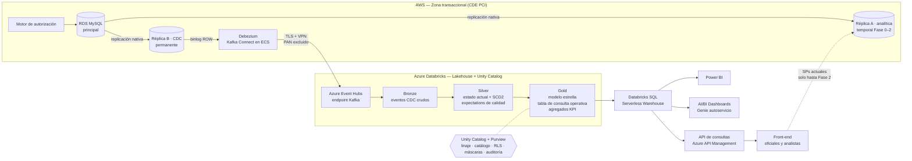

# Arquitectura de Datos para Adquirencia — Desacoplamiento OLTP / Analítica

Propuesta de arquitectura para proteger el sistema transaccional de adquirencia (Amazon RDS MySQL) y habilitar analítica gobernada sobre Azure Databricks.

> **Idea central:** la base que autoriza pagos no debe responder consultas analíticas. Los cambios se replican por CDC (binlog)hacia un Lakehouse en Azure Databricks, donde se modelan, gobiernan y sirven a los usuarios de negocio (patrón **CQRS**: un modelo para escribir, otro para leer).

---

## 1. Problema

Stored Procedures con _joins_ masivos y 11 filtros dinámicos se ejecutan en tiempo real sobre la misma base que autoriza transacciones. Saturan la CPU, retienen recursos de InnoDB, provocan HTTP 504 en API Gateway y ponen en riesgo la autorización de pagos.

## 2. Causas raíz (resumen)

| #   | Causa                                                                        | Efecto                                                                               |
| --- | ---------------------------------------------------------------------------- | ------------------------------------------------------------------------------------ |
| 1   | Cargas OLTP y OLAP en el mismo motor                                         | La analítica compite por CPU, I/O y buffer pool con la autorización                  |
| 2   | Modelo altamente normalizado + _joins_ de 6 tablas en cada consulta          | Planes de ejecución costosos, _full scans_ sobre 83M+ filas                          |
| 3   | 11 filtros combinables y opcionales                                          | Ningún índice cubre todas las combinaciones; el optimizador cae en escaneos          |
| 4   | Lecturas largas en InnoDB (MVCC, _undo_, tablas temporales, `INSERT…SELECT`) | Crecen el _history list_ y la contención; bloqueos sobre escrituras                  |
| 5   | Patrón síncrono Front → API Gateway → SP                                     | Cualquier consulta que exceda el límite de integración de API Gateway termina en 504 |
| 6   | Sin réplica de lectura, caché, particionamiento ni ciclo de vida             | El costo de cada consulta crece linealmente con el volumen (~460k trx/día)           |

Detalle en [`docs/arquitectura.md`](docs/arquitectura.md#a-desacoplamiento-operacional-y-rendimiento).

## 3. Arquitectura objetivo



**Flujo:** la principal solo autoriza. Se crean dos réplicas de lectura de RDS con propósitos distintos:

- **Réplica A (analítica, temporal):** recibe los Stored Procedures actuales desde la Fase 0 y se elimina en la Fase 2, cuando la API los reemplaza.
- **Réplica B (CDC, permanente):** Debezium lee su binlog (cero consultas sobre tablas) y publica en Event Hubs. Está separada de la A para que la carga de los SPs no retrase el CDC.

Databricks consume en _streaming_, aplica Medallion y expone Gold en un SQL Warehouse serverless que escala por concurrencia. Creación de las réplicas: [`src/aws/01_replicas_rds.sh`](src/aws/01_replicas_rds.sh).

## 4. Decisiones clave

Cada decisión está documentada como **ADR (Architecture Decision Record)** en [`docs/adr/`](docs/adr/):

| ADR                                                        | Decisión                                                                                           |
| ---------------------------------------------------------- | -------------------------------------------------------------------------------------------------- |
| [001](docs/adr/ADR-001-cdc-debezium-binlog.md)             | CDC por binlog con Debezium sobre réplica dedicada, en lugar de extracciones batch con SQL         |
| [002](docs/adr/ADR-002-lakehouse-azure-databricks.md)      | Lakehouse en Azure Databricks con Lakeflow Declarative Pipelines y Unity Catalog                   |
| [003](docs/adr/ADR-003-modelado-gold-liquid-clustering.md) | Modelo estrella + tabla ancha de consulta operativa con Liquid Clustering                          |
| [004](docs/adr/ADR-004-consumo-sql-warehouse-api.md)       | Consumo vía SQL Warehouse serverless y API con filtros parametrizados (fin de los SPs)             |
| [005](docs/adr/ADR-005-tratamiento-del-pan.md)             | El PAN se excluye en el origen; analítica con BIN, últimos 4 y token (Azure fuera del alcance PCI) |

## 5. Hoja de ruta

| Fase                        | Plazo estimado | Entregable                                                                                                                     | Valor                                                |
| --------------------------- | -------------- | ------------------------------------------------------------------------------------------------------------------------------ | ---------------------------------------------------- |
| 0 — Contención              | Semanas 1–2    | **Réplica A** para los SPs, usuario analítico con límites, índices compuestos ([`src/aws`](src/aws), [`src/mysql`](src/mysql)) | Detiene el impacto sobre pagos de inmediato          |
| 1 — Integración             | Semanas 3–6    | **Réplica B** + CDC Debezium → Event Hubs → Bronze/Silver + carga inicial desde snapshot                                       | Datos operacionales en Azure con latencia de minutos |
| 2 — Modelado y consumo      | Semanas 7–10   | Gold, SQL Warehouse, API de consultas, migración del front                                                                     | Se apagan los SPs y **se elimina la Réplica A**      |
| 3 — Gobierno y autoservicio | Semanas 11–14  | Catálogo, RLS, dashboards, Genie, cuadres automáticos                                                                          | Autoservicio gobernado y auditable                   |

## 6. Estructura del repositorio

```
├── README.md
├── docs/
│   ├── arquitectura.md          ← respuesta completa a los puntos A–E de la prueba
│   └── adr/                     ← decisiones de arquitectura justificadas
└── src/
    ├── aws/                     ← creación de las réplicas A y B de RDS (Fases 0 y 1)
    ├── mysql/                   ← contención inmediata (Fase 0)
    ├── cdc/                     ← configuración del conector Debezium
    ├── databricks/              ← pipelines Bronze/Silver/Gold y gobierno en Unity Catalog
    └── api/                     ← servicio de consultas que reemplaza los SPs (con tests)
```

## 7. Supuestos

- Las columnas de las tablas `bco_t_*` usadas en el código son **ilustrativas**; el diseño no depende de nombres exactos.
- El volumen (83M registros en 6 meses ≈ 460k/día ≈ 5 TPS promedio, con picos estimados de 10x) es holgado para Event Hubs y Databricks; el cuello de botella actual es de **arquitectura**, no de capacidad.
- El PAN (número de tarjeta) **no sale** del entorno PCI de AWS; analítica trabaja con BIN, últimos 4 dígitos y un token por tarjeta generado en el origen.
- Existe conectividad privada entre AWS y Azure (VPN site-to-site o interconexión dedicada).

---
